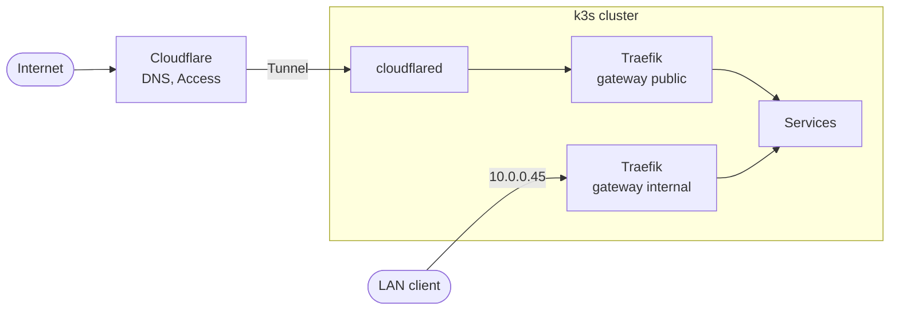

# homelab

Infrastructure as code for a three-node k3s cluster on Proxmox VE, managed with OpenTofu, Ansible, Argo CD and Renovate.

## Overview

- [OpenTofu](https://opentofu.org) creates the virtual machines, the Cloudflare DNS records and the Cloudflare Tunnel.
- [Ansible](https://www.ansible.com) configures the nodes and installs k3s.
- [Argo CD](https://argo-cd.readthedocs.io) deploys everything in the cluster from this repository.
- [Renovate](https://docs.renovatebot.com) opens pull requests for chart, image, k3s and kube-vip updates.

## Hardware

| Host | Model | CPU | RAM | k3s VM |
|---|---|---|---|---|
| dojo | Lenovo ThinkCentre M910q | Intel Core i5-6600T | 16 GB | k3s-dojo, 2 vCPU, 10 GB |
| tojo | HP ProDesk 600 G3 DM | Intel Core i3-7100T | 12 GB | k3s-tojo, 2 vCPU, 8 GB, GVT-g virtual GPU |
| mojo | HP ProDesk 600 G4 DM | Intel Core i3-8100T | 8 GB | k3s-mojo, 2 vCPU, 4 GB |

The three hosts form one Proxmox VE cluster. Besides the k3s VMs they run LXC containers for services that have not moved into the cluster yet. The hosts and those containers are managed in a separate repository. tojo also serves NFS for media and hosts the restic REST server for backups.

## Kubernetes

### Core components

- **Cluster:** [k3s](https://k3s.io) with three server nodes and embedded etcd. [kube-vip](https://kube-vip.io) provides virtual IPs for the Kubernetes API and the LAN gateway.
- **Networking:** [Traefik](https://traefik.io/traefik) implements the Gateway API with two gateways, `internal` for the LAN and `public` for the tunnel. [cloudflared](https://github.com/cloudflare/cloudflared) connects the `public` gateway to Cloudflare. [cert-manager](https://cert-manager.io) issues a Let's Encrypt wildcard certificate via DNS-01.
- **Secrets:** [Sealed Secrets](https://github.com/bitnami-labs/sealed-secrets) keeps every Secret encrypted in Git.
- **Storage and backups:** the k3s `local-path` provisioner for application data, static NFS volumes for media, and [k8up](https://k8up.io) for restic backups.
- **Databases:** [CloudNativePG](https://cloudnative-pg.io) runs PostgreSQL for applications that need a database server.
- **Monitoring:** [kube-prometheus-stack](https://github.com/prometheus-community/helm-charts/tree/main/charts/kube-prometheus-stack) with Prometheus, Alertmanager and Grafana.
- **Devices:** the [Intel GPU device plugin](https://github.com/intel/intel-device-plugins-for-kubernetes) exposes the GVT-g virtual GPU for hardware transcoding.

### Applications

| Application | Purpose |
|---|---|
| Static websites | nginx with [git-sync](https://github.com/kubernetes/git-sync) |
| [Glance](https://github.com/glanceapp/glance) | Dashboard |
| [Kavita](https://www.kavitareader.com) | E-book library |
| [File Browser](https://filebrowser.org) | Web file manager for the media share |
| [Jellyfin](https://jellyfin.org) | Media server with Intel Quick Sync transcoding |
| [kobser](https://github.com/kobsermusic/kobser), [Navidrome](https://www.navidrome.org) | Music downloader and music streaming server |
| [qBittorrent](https://www.qbittorrent.org) | Torrent client, traffic routed through a [gluetun](https://github.com/qdm12/gluetun) WireGuard sidecar |
| [Paperless-ngx](https://docs.paperless-ngx.com) | Document archive with OCR, scans arrive from the printer over FTP |
| [Nextcloud](https://nextcloud.com) | File sync and sharing, on PostgreSQL |
| [Nextcloud](https://nextcloud.com), second instance | File sync, group folders and document editing for a small company, with its own database and backups |
| [Immich](https://immich.app) | Photo library with face recognition and smart search, on PostgreSQL with [VectorChord](https://github.com/tensorchord/VectorChord) |
| [Vaultwarden](https://github.com/dani-garcia/vaultwarden) | Password manager, compatible with the Bitwarden clients |

### GitOps

Argo CD uses the app-of-apps pattern. The root Application watches `kubernetes/apps/`, which holds one Application per component. Each Application points to a Helm chart with values from this repository, to a directory of manifests, or to both.

```
kubernetes/
├── root.yaml       # root Application
├── apps/           # one Argo CD Application per component
└── <component>/    # Helm values, manifests and SealedSecrets
```

The `argocd` Application is synced manually. All other Applications sync automatically with pruning and self-heal enabled.

### Networking



- **LAN:** `*.k8s.unterhaken.at` resolves to `10.0.0.45`, a public DNS record with a private address. kube-vip announces the address from one of the nodes, and Traefik terminates TLS with the wildcard certificate.
- **Public:** each public hostname is a proxied CNAME record pointing to the Cloudflare Tunnel. cloudflared holds an outbound connection to Cloudflare and forwards requests to the `public` gateway. Cloudflare Access protects the applications that are not meant to be public.
- The cluster has no ports open to the internet.

| Address | Assignment |
|---|---|
| 10.0.0.40 | Kubernetes API (kube-vip) |
| 10.0.0.41-43 | k3s-dojo, k3s-tojo, k3s-mojo |
| 10.0.0.45 | Traefik, gateway `internal` |
| 10.0.0.46 | Paperless FTP, reachable from the printer only |

Addresses below 10.0.0.100 are outside the DHCP range and assigned statically.

## Storage and backups

- Application configuration and databases use `local-path` volumes, pinned to one node.
- Media is mounted from the NFS server on tojo through static PersistentVolumes.
- k8up backs up the `local-path` volumes every night to the restic REST server on tojo. Applications with a database also back up an SQL dump taken before each run: `sqlite3 .dump` for SQLite, `pg_dump` for PostgreSQL.
- Retention is 14 daily, 8 weekly and 6 monthly snapshots. Prune and check run on Sundays.
- NFS volumes are excluded with the label `k8up.io/backup: "false"`.
- tojo copies the restic repository offsite every morning.

## Monitoring

- Prometheus scrapes the cluster, Argo CD, cert-manager, k8up and Sealed Secrets.
- Alertmanager sends alerts to Telegram.
- The Watchdog alert pings a Healthchecks.io check, which notifies by email when alerting stops working.
- Additional alert rules in `kubernetes/kube-prometheus-stack/manifests/` cover certificates, Argo CD applications, backups, node readiness and SealedSecrets.

## Secrets

Every Kubernetes Secret is stored in Git as a SealedSecret, in a file `sealedsecret-<name>.yaml` next to the application. Only the controller in the cluster can decrypt them. The controller's private key is backed up outside the cluster. See [docs/secrets.md](docs/secrets.md).

## Cloud dependencies

Everything runs at home except the following.

| Service | Used for |
|---|---|
| Cloudflare | DNS, Tunnel, Access, R2 for OpenTofu state |
| GitHub | This repository, container images for own projects |
| Renovate | Dependency update pull requests |
| Let's Encrypt | TLS certificates |
| Healthchecks.io | Notification when alerting or backups stop reporting |
| Telegram | Alert notifications |
| Hetzner Storage Box | Offsite copy of the restic repositories |
| Mullvad | VPN for qBittorrent |

## Repository structure

```
.
├── ansible/             # node configuration, GPU kernel, k3s, kube-vip
├── docs/                # procedures
├── kubernetes/          # everything Argo CD deploys
├── opentofu/            # Proxmox VMs, generates the Ansible inventory
│   └── cloudflare/      # DNS records and the Cloudflare Tunnel
└── renovate.json
```

## Documentation

| Document | Contents |
|---|---|
| [docs/rebuild.md](docs/rebuild.md) | Building the cluster from scratch |
| [docs/secrets.md](docs/secrets.md) | Creating, changing and recovering Secrets |
| [docs/opentofu.md](docs/opentofu.md) | State, credentials and setup on a new machine |
